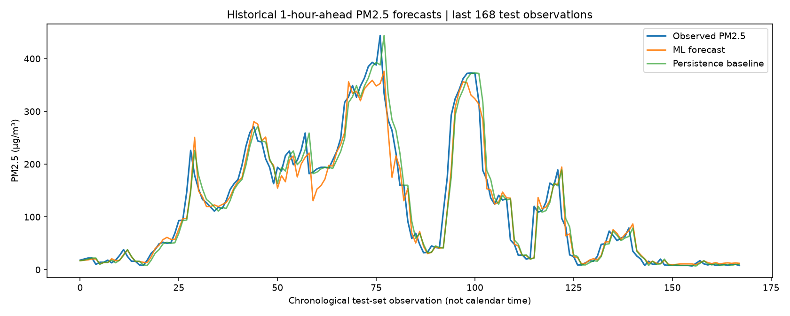

# Air Quality ML Forecaster 🌫️

**One-hour-ahead PM2.5 forecasting** using hourly air-pollution measurements and weather data, Python, pandas, scikit-learn and a local Streamlit dashboard.

> **Portfolio provenance:** This is a newly created, AI-assisted portfolio reconstruction inspired by an earlier lost university air-pollution assignment. It is **not** the original university submission and has not been deployed or used in production. Review, run and understand the code before describing your contributions in a job application.

## Project features

- Trains using the public **Beijing PM2.5** dataset (UCI Machine Learning Repository), with hourly readings collected during 2010–2014.
- Forecasts the **next hour's PM2.5 concentration**, in micrograms per cubic meter (µg/m³).
- Input features include current/lagged pollution readings, a rolling mean, dew point, temperature, atmospheric pressure, wind and precipitation, plus date features.
- Uses a **chronological 70/15/15 train/validation/test split** instead of randomly splitting time-series data, with a one-hour separation of targets across boundaries.
- Compares `HistGradientBoostingRegressor` to a **persistence baseline**, which predicts the current PM2.5 as next-hour PM2.5.
- Exports MAE, RMSE, R², test predictions and a trained model after running training.
- Includes local **Streamlit dashboard**, command-line prediction and six automated tests.

## Quick start — Windows PowerShell

Install Python 3.11 or newer, open PowerShell inside the project folder, and run:

```powershell
py -3 -m venv .venv
.\.venv\Scripts\Activate.ps1
python -m pip install --upgrade pip
pip install -r requirements-dev.txt
python scripts/download_data.py
python train.py
python predict.py
streamlit run app.py
```

If activation is blocked, use `.\.venv\Scripts\python.exe` instead of `python` and `.\.venv\Scripts\streamlit.exe` instead of `streamlit`.

**Mac / Linux:**

```bash
python3 -m venv .venv
source .venv/bin/activate
pip install -r requirements-dev.txt
python scripts/download_data.py
python train.py
python predict.py
streamlit run app.py
```

Tests:

```bash
python -m pytest -q
```

To generate a measured evaluation report and a PNG plot after real training:

```bash
python scripts/render_results.py
```

You can also run the GitHub Actions workflow [Real-data training and evaluation](.github/workflows/train-evaluate.yml) from the **Actions** tab. When GitHub Actions has permission to run and push, it publishes measured metrics and the historical forecast plot to the [`results/`](results/) folder. If that folder is not yet available, **real-data training has not been verified**; do not claim numerical accuracy.


## Repository layout

```text
air_quality/features.py       # CSV validation, chronological features and labels
air_quality/model.py          # ML pipeline, evaluation and prediction
scripts/download_data.py      # Download source dataset
train.py                      # Train and evaluate
predict.py                    # Command-line inference
app.py                        # Local Streamlit dashboard
tests/                        # Automated tests using synthetic data
data/                         # Local dataset (gitignored)
artifacts/                    # Local trained model and results (gitignored)
DATA_LICENSE.md               # Dataset attribution and license
```

## Real-dataset evaluation (verified 21 Nov 2026)

The model was trained on the original UCI Beijing PM2.5 historical measurements and evaluated on **6,455 unseen chronological test observations**. The measured one-hour-ahead results are:

| Approach | MAE (µg/m³) ↓ | RMSE (µg/m³) ↓ | R² ↑ |
|---|---:|---:|---:|
| **Gradient boosting model** | **10.4606** | **18.5857** | **0.9441** |
| Persistence baseline | 10.9645 | 20.0609 | 0.9348 |

This was **4.6% lower MAE** than predicting that the next hour equals the current PM2.5. The baseline is already strong; this is a modest measured improvement, not a production-accuracy claim.



[Full evaluation methodology, plot and model-vs-baseline report](results/EVALUATION.md) · [All measured train/validation/test metrics (JSON)](results/metrics.json) · [Successful real-data GitHub Actions run](https://github.com/jimkaradim/air-quality-ml-forecaster/actions/runs/44883879936)

## Evaluation and methodological notes

The target is the PM2.5 reading at time **t+1**. Features use only measurements available through **t**, with the current pollution reading assumed available at prediction time. Observations with missing targets or non-consecutive next-hour timestamps are removed. A training-only median imputer handles missing numeric weather inputs and one-hot encoding handles wind direction. Predictions are clipped to nonnegative values.

The above real-data figures were generated in a GitHub Actions run and written to [`results/`](results/). You can reproduce them by running `python train.py` on the original UCI CSV, followed by `python scripts/render_results.py`. The CI unit tests use synthetic fixtures and do **not** measure real-world accuracy.

This historical model does not forecast current air quality in Athens or modern Beijing. It should not be used for public-safety, regulatory or health decisions. Model artifact files should only be loaded if trusted.

## Dataset attribution

Chen, S. (2015). *Beijing PM2.5* [Dataset]. UCI Machine Learning Repository. [DOI: 10.24432/C5JS49](https://doi.org/10.24432/C5JS49). Licensed **CC BY 4.0**. The full CSV is downloaded separately, not committed to this repository. See [DATA_LICENSE.md](DATA_LICENSE.md).

Source code is MIT-licensed; this license does not change the third-party dataset's rights.
