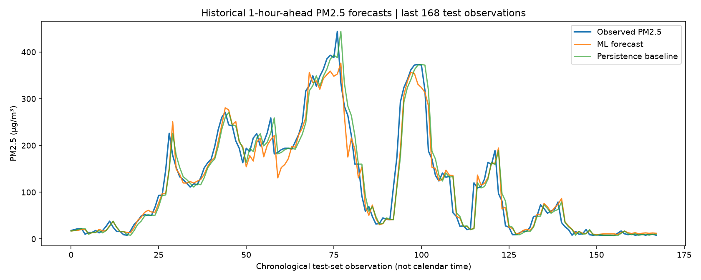

# Measured results on the original UCI Beijing PM2.5 dataset

This evaluation was generated by running the repository training code on real historical UCI Beijing PM2.5 hourly observations (2010–2014); it is **not** synthetic test output.

## Held-out chronological test split

| Approach | MAE (µg/m³) | RMSE (µg/m³) | R² |
|---|---:|---:|---:|
| HistGradientBoostingRegressor | 10.4606 | 18.5857 | 0.9441 |
| Persistence (PM2.5 at t) | 10.9645 | 20.0609 | 0.9348 |

Model test MAE was **lower** than the persistence baseline by **0.5039 µg/m³**. This is one historical hold-out evaluation, not a guarantee of future performance.

Test observations: **6,455**. Evaluation method: Chronological 70/15/15 raw-row split; one-hour boundary embargo; no shuffle.

See [metrics.json](metrics.json) for metrics on train, validation and test splits. The screenshot above shows an indexed 168-observation test window, not a live forecast.

Dataset attribution: Chen, S. (2015), Beijing PM2.5, UCI ML Repository, CC BY 4.0. https://doi.org/10.24432/C5JS49
